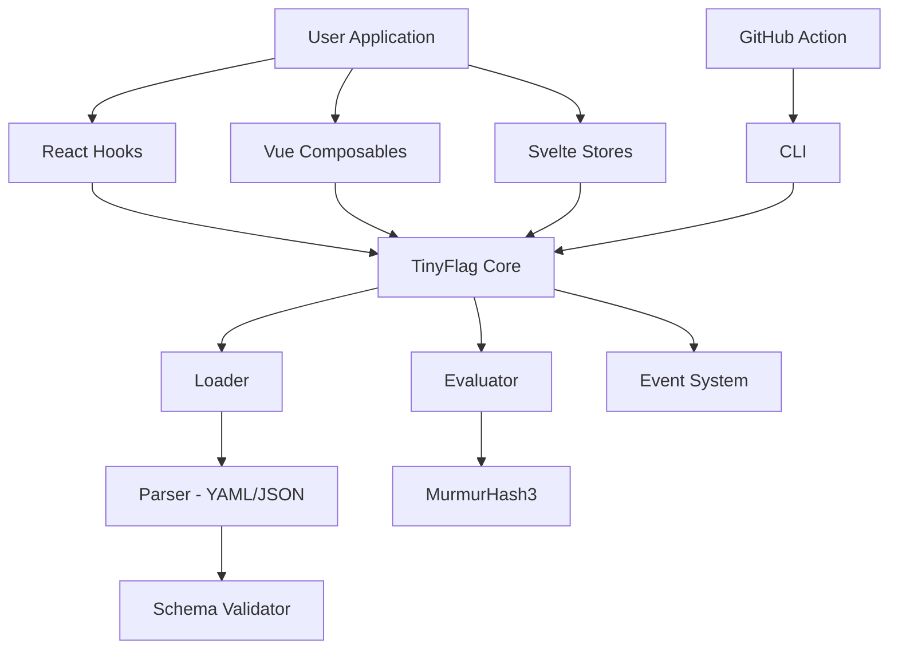
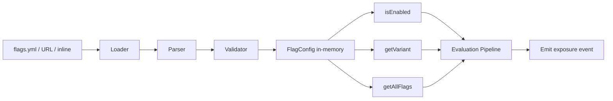

# Architecture & Design Decisions

## Overview

TinyFlag is a pnpm monorepo with independently versioned packages:

```
tinyflag/
├── packages/
│   ├── core/          → tinyflag (npm)
│   ├── react/         → tinyflag-react (npm)
│   ├── vue/           → tinyflag-vue (npm)
│   ├── svelte/        → tinyflag-svelte (npm)
│   ├── cli/           → tinyflag-cli (npm)
│   ├── github-action/ → composite GitHub Action
│   └── dashboard/     → single HTML file
├── examples/          → 7 example apps
├── docs/              → documentation
└── flags.schema.json  → JSON Schema
```

## Component Diagram



### Data Flow



**Evaluation pipeline:**

1. Check overrides
2. Check `enabled` flag
3. Evaluate rules (conditions)
4. Rollout check (MurmurHash3)
5. Variant assignment (MurmurHash3)

## Key Decisions

### Zero Dependencies

The core package has zero npm runtime `dependencies`. This is achieved by:

- Custom built-in YAML parser (~3KB)
- Custom MurmurHash3 implementation (~200B)
- Pure TypeScript with no external libraries

### Deterministic Hashing

MurmurHash3 (32-bit) is used for both rollout bucketing and variant assignment. The algorithm and seed values are frozen — they will never change in a way that alters existing assignments.

- **Rollout:** `murmurhash3("flagName:userId", seed=0) % 100`
- **Variants:** `murmurhash3("flagName:userId", seed=0x5f3759df) % totalWeight`

Different seeds ensure rollout and variant assignment are independent.

### Evaluation Never Throws

`isEnabled()` and `getVariant()` never throw exceptions. Errors are emitted via the `error` event. This prevents feature flags from crashing the host application.

### File-Driven, Git-Native

Flag definitions live in YAML/JSON files committed to Git. This means:

- Changes are reviewed in PRs
- History is tracked by Git
- No dashboard or server needed
- No vendor lock-in

### Build & Module Format

- **Build tool:** tsup (esbuild-based)
- **Output:** Dual ESM + CJS via `package.json` `exports` map
- **Target:** ES2020
- **Tree-shaking:** Framework bindings are separate packages — unused ones are never bundled

## Architecture Decision Records

For detailed rationale behind each design choice, see the [ADRs](https://github.com/josedab/tinyflag/tree/main/docs/adr):

| ADR                                                                                                             | Decision                                |
| --------------------------------------------------------------------------------------------------------------- | --------------------------------------- |
| [ADR-0001](https://github.com/josedab/tinyflag/blob/main/docs/adr/0001-zero-runtime-dependencies.md)            | Zero Runtime Dependencies               |
| [ADR-0002](https://github.com/josedab/tinyflag/blob/main/docs/adr/0002-file-driven-git-native-storage.md)       | File-Driven, Git-Native Storage         |
| [ADR-0003](https://github.com/josedab/tinyflag/blob/main/docs/adr/0003-custom-yaml-parser.md)                   | Custom YAML Parser                      |
| [ADR-0004](https://github.com/josedab/tinyflag/blob/main/docs/adr/0004-murmurhash3-deterministic-bucketing.md)  | MurmurHash3 Deterministic Bucketing     |
| [ADR-0005](https://github.com/josedab/tinyflag/blob/main/docs/adr/0005-evaluation-never-throws.md)              | Evaluation Never Throws                 |
| [ADR-0006](https://github.com/josedab/tinyflag/blob/main/docs/adr/0006-pnpm-monorepo.md)                        | pnpm Monorepo                           |
| [ADR-0007](https://github.com/josedab/tinyflag/blob/main/docs/adr/0007-dual-esm-cjs-output.md)                  | Dual ESM/CJS Output                     |
| [ADR-0008](https://github.com/josedab/tinyflag/blob/main/docs/adr/0008-framework-bindings-separate-packages.md) | Framework Bindings as Separate Packages |
| [ADR-0009](https://github.com/josedab/tinyflag/blob/main/docs/adr/0009-event-based-error-reporting.md)          | Event-Based Error Reporting             |
| [ADR-0010](https://github.com/josedab/tinyflag/blob/main/docs/adr/0010-dynamic-fs-import-universal-runtime.md)  | Dynamic fs Import                       |
