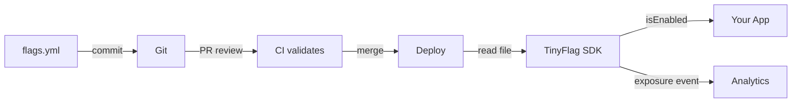

# Why TinyFlag

## The Problem with Feature Flag Services

Traditional feature flag platforms (LaunchDarkly, Unleash, GrowthBook) require:

- **A server or SaaS** — infrastructure to provision, monitor, and pay for
- **API keys and network calls** — latency on every evaluation, availability risk
- **A separate workflow** — flag changes happen in a dashboard, not in your Git history
- **Vendor lock-in** — proprietary SDKs, data formats, and APIs
- **Per-seat pricing** — costs scale with your team, not your usage

## TinyFlag's Approach

TinyFlag takes a fundamentally different approach: **flags are files, not services**.

```yaml title="flags.yml"
version: 1
flags:
  new-checkout:
    enabled: true
    rollout: 50
```

That's it. No server, no API keys, no dashboard. Define flags in YAML, commit to Git, evaluate in-process.

## Feature Comparison

| Capability        | LaunchDarkly | Unleash      | GrowthBook   | **TinyFlag** |
| ----------------- | ------------ | ------------ | ------------ | ------------ |
| Requires server   | ✅ SaaS      | ✅ Self-host | ✅ Self-host | **❌ No**    |
| Git-native flags  | ❌           | ❌           | ❌           | **✅**       |
| Zero dependencies | ❌           | ❌           | ❌           | **✅**       |
| Bundle size       | ~50KB        | ~30KB        | ~20KB        | **< 8KB**    |
| Edge/serverless   | Partial      | ❌           | Partial      | **✅**       |
| A/B testing       | ✅           | ✅           | ✅           | **✅**       |
| Targeting rules   | ✅           | ✅           | ✅           | **✅**       |
| React/Vue/Svelte  | ✅           | ✅           | React only   | **✅**       |
| SSR support       | ✅           | ❌           | ✅           | **✅**       |
| OpenFeature       | ✅           | ✅           | ✅           | **✅**       |
| Free forever      | ❌           | Free tier    | Free tier    | **✅**       |

## When TinyFlag is the Right Choice

✅ **Choose TinyFlag when:**

- You want feature flags without infrastructure complexity
- Your team already uses Git for configuration management
- You need flags in edge/serverless runtimes where SDK size matters
- You want full audit trail via Git history (who changed what, when, in which PR)
- You're cost-conscious and don't want per-seat pricing
- You want to evaluate flags offline, with zero network dependency

## When to Consider Alternatives

⚠️ **Consider a SaaS solution when:**

- Non-technical stakeholders need a visual dashboard to toggle flags in real-time
- You need sub-second flag propagation without a deploy cycle
- You need built-in experimentation analytics and statistical significance calculations
- You have compliance requirements that mandate a managed service with SOC 2 / HIPAA

## Performance

TinyFlag is designed for hot-path evaluation:

| Benchmark              | Result                                 |
| ---------------------- | -------------------------------------- |
| `isEnabled()`          | **0.0025ms** per call (400K evals/sec) |
| `getVariant()`         | **0.0024ms** per call                  |
| `evaluateFlag()` (raw) | **0.001ms** per call (1M evals/sec)    |
| SDK init (100 flags)   | **< 1ms**                              |
| Bundle size (gzipped)  | **< 8KB**                              |
| Runtime dependencies   | **0**                                  |

Benchmarks run on Node.js 22, Apple M-series. See `packages/core/src/__tests__/benchmark.test.ts` for methodology.

## Architecture



The entire lifecycle lives in your existing Git workflow. No new infrastructure, no new dashboards, no new vendor relationships.
